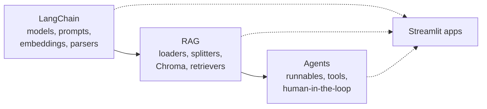
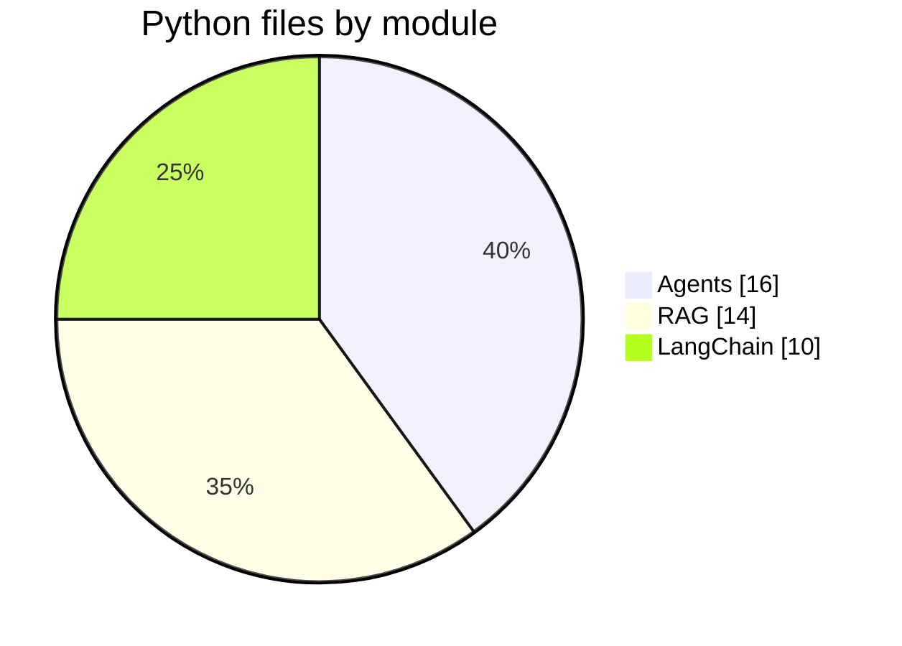
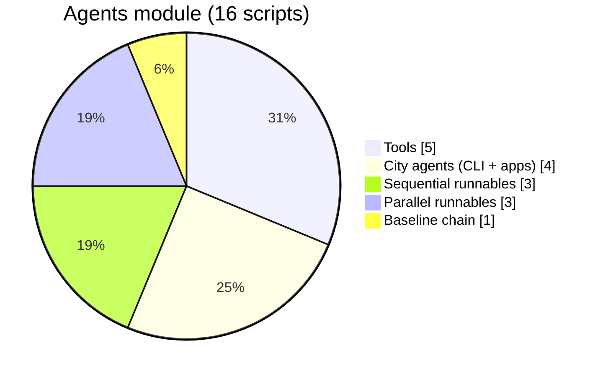
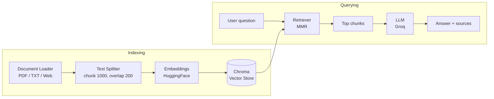
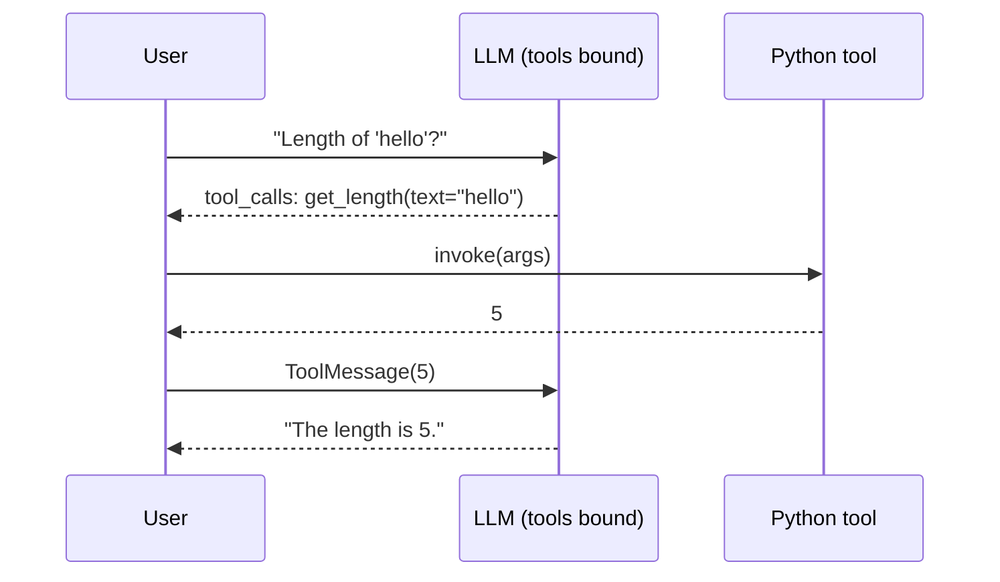
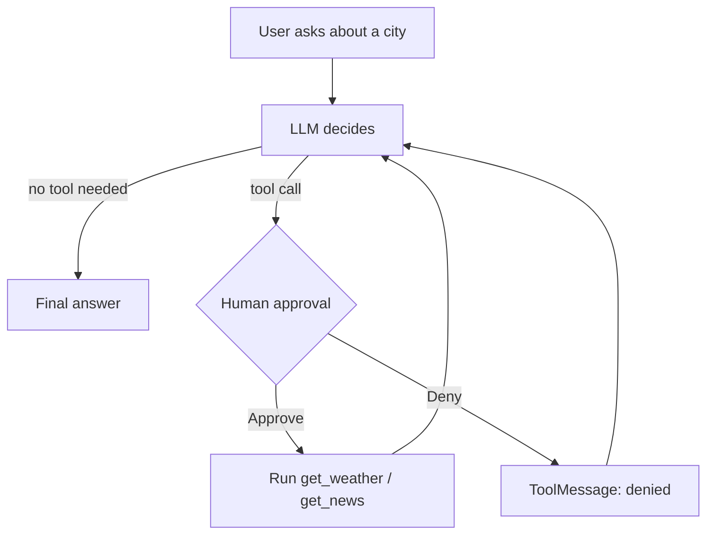

<p align="center">
  
</p>

<p align="center">
  
  
  
  
  
  
  
  
  
  
</p>

<p align="center">
  
  
  
  
  
</p>

# Generative AI: Learning by Building

My hands-on journey through Generative AI using **LangChain**. Each concept has a small, runnable project instead of just notes.

The repo has three modules that build on each other:

1. **LangChain**: models, prompts, embeddings, structured output
2. **RAG**: loaders, splitters, vector store, retrievers, a full PDF Q&A app
3. **Agents**: runnables, tool calling, human-in-the-loop agents

---

## In Simple Words (No Tech Background Needed)

**What is this project?**

- I am learning how modern AI tools like ChatGPT-style assistants are built.
- For every idea I learned, I built a small working project.
- This repo is the collection of those projects.

**What can these projects do?**

| Project | What it does in plain English |
|---------|-------------------------------|
| PDF Assistant | You upload a PDF. You ask questions. It answers using only that PDF and shows the page it used. |
| Movie Info Extractor | You paste a movie description. It returns neat details: title, year, cast, rating. |
| City Assistant | You ask about weather or news in a city. It asks your permission before looking anything up. |
| TRON Chatbot | A friendly chatbot with a personality (funny, angry or sad). |

**Key words, explained simply**

| Term | Simple meaning |
|------|----------------|
| **LLM** (Large Language Model) | The AI "brain" that reads and writes text, like the one behind ChatGPT. |
| **LangChain** | A toolkit that connects the AI brain to prompts, files and other tools. |
| **Embeddings** | Turning text into numbers so a computer can tell which texts mean similar things. |
| **Vector database** | A smart filing cabinet that finds text by meaning, not exact words. |
| **RAG** | Like an open-book exam: the AI first looks up the right pages, then answers from them. |
| **Tool** | A skill the AI can use, like checking the weather or searching news. |
| **Agent** | An AI assistant that decides which tool to use and when. |
| **Human-in-the-loop** | The AI asks a person to approve before it acts. |
| **Streamlit** | A way to turn Python code into a simple web page anyone can click through. |

**Why this matters**

- Plain AI chatbots can make up answers. RAG makes them answer from real documents.
- Letting AI use tools makes it more useful.
- Asking for approval keeps a human in control.

---

## Quick Navigation

- [Overview graphs](#overview)
- [Repository structure](#repository-structure) (for developers)
- [Setup and run](#setup)
- [Key learnings](#key-learnings)

---

## Overview

**Learning path**



**Python scripts per module (40 total)**



**Where the Agents scripts go**



---

## Repository Structure

> From here on, the content is for developers.

```
Generative-AI/
├── LangChain/
│   ├── chatmodels/                  # chat models + chatbots
│   ├── embeddingmodels/             # Google + HuggingFace embeddings
│   ├── Structured Output and Parser/# Pydantic parsing, movie extractor app
│   └── Chapter -2 RAG.txt           # RAG flow notes
│
├── RAG/
│   ├── documentLoaders/             # PDF, text, web loaders
│   ├── textSplitter/                # character, recursive, token splitters
│   ├── vector Store/                # Chroma basics
│   ├── retrivers/                   # similarity, MMR, multi-query, Arxiv
│   ├── create_database.py           # build persistent Chroma DB from a PDF
│   ├── main.py                      # terminal RAG chatbot
│   └── app.py                       # Streamlit PDF RAG assistant
│
└── Agents/
    ├── Normal Code/                 # chain without runnables (baseline)
    ├── Sequential Runnable/         # step-by-step chains
    ├── Parllel Runnable/            # parallel chains, passthrough
    ├── tool/                        # custom tools, binding, tool calling
    ├── Agent/                       # city agents (CLI + Streamlit apps)
    ├── Main Concepts.txt            # syllabus for this module
    └── Doubts.txt                   # my Q&A notes (runnables, tool calling)
```

---

## Module 1: LangChain

| File | What it does |
|------|--------------|
| `chatmodels/chat.py` | Calls chat models from Gemini, Groq and Mistral. Notes on `temperature` and `max_tokens` |
| `chatmodels/chatbot.py` | Terminal chatbot "TRON" with funny / angry / sad modes using system messages and message history |
| `chatmodels/UIChatbot.py` | Streamlit version of TRON with chat UI and session memory |
| `chatmodels/huggingface.py` | Runs an open-source model (TinyLlama) locally with `HuggingFacePipeline` |
| `embeddingmodels/embeddings.py` | Google Gemini embeddings with custom output dimensions |
| `embeddingmodels/huggingface_embeddings.py` | Local embeddings with `all-MiniLM-L6-v2` |
| `Structured Output and Parser/Parser.py` | Extracts movie details into a Pydantic `Movie` model using `PydanticOutputParser` |
| `Structured Output and Parser/Chatbot_Formatted.py` | Streamlit app: paste a movie paragraph, get structured JSON |

---

## Module 2: RAG (Retrieval-Augmented Generation)

**Pipeline**



**Components explored**

| Stage | Files |
|-------|-------|
| Document loaders | `pdfLoader.py`, `txtLoader.py`, `webLoader.py` (summarise any source with an LLM) |
| Text splitters | `charcterSplitter.py`, `recursiveTextsplitter.py`, `tokenTextSplitter..py` |
| Vector store | `vector Store/DB.py` (Chroma with metadata + similarity search) |
| Retrievers | `similarityTechniques.py` (similarity vs MMR), `multiqueryRetriever.py`, `SorceBasedRetrival.py` (Arxiv) |

**Projects**

- **`create_database.py` + `main.py`**: builds a persistent Chroma DB from a PDF (1000 chunk size, 200 overlap, `all-mpnet-base-v2`), then runs a terminal Q&A bot using MMR retrieval and a Groq LLM. The prompt forces answers from context only.
- **`app.py`: PDF RAG Assistant (Streamlit)**
  - Upload one or more PDFs and ask questions
  - Answers come only from the uploaded documents
  - Every answer shows source file and page number
  - In-memory index (nothing stored on disk), rebuilt only when files change
  - Cached embedding model and LLM, 30 MB upload guard
  - API key from `.env` locally or Streamlit secrets when deployed

---

## Module 3: Agents

**Runnables**

| File | Concept |
|------|---------|
| `Normal Code/WithoutRunnablesCode.py` | Baseline: prompt, model and parser chained with `|` |
| `Sequential Runnable/sequentialRunnableUsing TheMultipleInputs.py` | Output of one step feeds the next (short answer -> detailed answer) |
| `Sequential Runnable/SequentialRunnablesWithMultipleInputs.py` | Shows why sequential chains lose the other inputs |
| `Parllel Runnable/parllelrunnableDifferentInputs.py` | `RunnableParallel` with a different input per branch |
| `Parllel Runnable/runnblePassthrough.py` | `RunnablePassthrough`: generate code, then explain it in parallel |

**Tool calling flow (the LLM decides, Python executes)**



**Tools and tool calling**

| File | Concept |
|------|---------|
| `tool/CustomTool.py` | Building a tool with `@tool` and inspecting its name, args, description |
| `tool/toolCalling.py` | Plain LLM vs LLM with bound tools |
| `tool/ToolCallingWithoutMessages.py` | Manual flow: read `tool_calls`, execute, send result back |
| `tool/ToolCallingUsingMessages.py` | Full message flow: `HumanMessage` -> `AIMessage` -> `ToolMessage` |
| `tool/Newssummrizer.py` | Tavily search results summarised into bullet points |

**Human-in-the-loop agent flow**



**Agents (City Intelligence)**

Weather (OpenWeather) and news (Tavily) tools driven by a Groq LLM, with **human approval before every tool call**.

| File | Approach |
|------|----------|
| `Agent/Agents Human in the Loop.py` | Agent loop written manually, terminal approval |
| `Agent/Agents with Automation.py` | Uses `create_agent` with `wrap_tool_call` middleware for approval |
| `Agent/app.py` | Streamlit "City Intelligence System": dark UI, Approve / Deny buttons, news cards, session stats |
| `Agent/app2.py` | Streamlit "Atlas": plain LangChain (no agent framework), approval cards, weather and news result cards, API key status |

---

## Tech Stack

- **Language**: Python
- **Framework**: LangChain (core, community, classic, text-splitters)
- **LLMs**: Groq (`openai/gpt-oss-20b`), Mistral, Google Gemini, HuggingFace (TinyLlama)
- **Embeddings**: HuggingFace sentence-transformers, Google Gemini embeddings
- **Vector DB**: ChromaDB
- **Tools / APIs**: Tavily (news search), OpenWeather, Arxiv
- **UI**: Streamlit
- **Other**: Pydantic, PyPDF, python-dotenv, Rich

---

## Setup

**1. Clone and create a virtual environment**

```bash
git clone https://github.com/Precipitation-Rain/Generative-AI.git
cd Generative-AI
python -m venv .venv
source .venv/bin/activate        # Windows: .venv\Scripts\activate
```

**2. Install dependencies**

Each module has its own `requirements.txt`, but they do not cover every import. This installs everything used across the repo:

```bash
pip install langchain langchain-core langchain-community langchain-classic \
    langchain-groq langchain-mistralai langchain-google-genai \
    langchain-huggingface langchain-chroma langchain-text-splitters \
    chromadb sentence-transformers transformers torch \
    pypdf beautifulsoup4 tiktoken arxiv \
    tavily-python requests streamlit rich python-dotenv
```

**3. Add API keys**

Create a `.env` file in the folder you run from. Add only the keys you need:

```env
GROQ_API_KEY=your_key
MISTRAL_API_KEY=your_key
GOOGLE_API_KEY=your_key
TAVILY_API_KEY=your_key
OPENWEATHER_API_KEY=your_key
```

---

## Running the Projects

```bash
# LangChain: terminal chatbot / Streamlit chatbot / movie extractor
python LangChain/chatmodels/chatbot.py
streamlit run LangChain/chatmodels/UIChatbot.py
streamlit run "LangChain/Structured Output and Parser/Chatbot_Formatted.py"

# RAG: PDF assistant
cd RAG
streamlit run app.py

# RAG: terminal bot (build the DB first)
python create_database.py
python main.py

# Agents: city assistants
cd Agents/Agent
streamlit run app.py
streamlit run app2.py
python "Agents with Automation.py"
```

> Some practice scripts in `RAG/documentLoaders` and `RAG/textSplitter` use local Windows file paths (`D:\Study\...`). Change them to your own file path before running.

---

## Key Learnings

- Retrieval quality matters as much as the model in a RAG system
- Chunk size and overlap change answer quality, so tune them
- MMR retrieval reduces repeated chunks compared to plain similarity search
- The LLM only **decides** which tool to call; Python **executes** it
- Runnables make chains reusable; parallel runnables handle independent inputs cleanly
- Human-in-the-loop approval makes agents safer to use
- Caching models and building the index once makes Streamlit apps much faster

---

## Notes

- `Agents/Doubts.txt`: my own Q&A notes on runnables and tool calling
- `Agents/Main Concepts.txt` and `LangChain/Chapter -2 RAG.txt`: module outlines

---

## Author

**Rajvardhan Shewale**
Final-year B.Tech CSE (AI & ML), Rajarambapu Institute of Technology, Sangli

GitHub: [Precipitation-Rain](https://github.com/Precipitation-Rain)